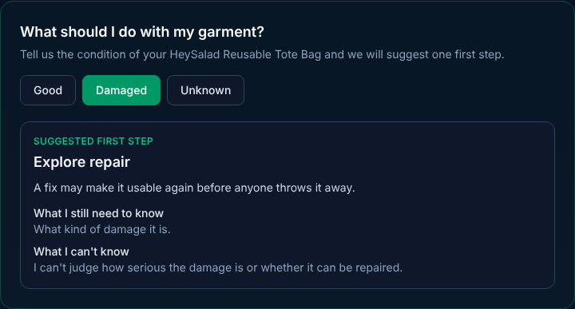

# Circularity Next Step: a ProductPass extension

This repository is my fork of [ProductPass](https://github.com/chilu18/product-pass), an open-source prototype for creating QR-powered Digital Product Passports for small fashion and textile brands. **I added one small feature, "Circularity Next Step".** The original ProductPass README is kept unchanged below the line at the bottom of this section.

- **My fork:** https://github.com/dewimeza/product-pass
- **Original project:** https://github.com/chilu18/product-pass (MIT license)

## What I added

The public passport page, the page a customer sees after scanning a garment's QR code, only shows information. The six "Circular commerce" boxes at the bottom were all marked "Coming soon", and the app never asked about the **condition** of the garment.

Circularity Next Step fills that gap. The customer reports the condition of their garment (**Good**, **Damaged**, or **Unknown**), and the app suggests **one** first step, with a short reason, what it still needs to know, and what it can't know.



## The three rules

| Condition reported | Suggested first step | Why |
|---|---|---|
| Good | Keep it or donate it | It still works, so it can keep being used, by you or by someone else |
| Damaged | Explore repair | A fix may make it usable again before anyone throws it away |
| Unknown | Ask for more information | The app can't suggest anything without knowing the condition |

The rules are fixed and always give the same answer for the same input. **This version does not use AI.**

## Try it

```bash
npm install
npm run dev
```

Open [http://localhost:3023/passport/heysalad-reusable-tote-bag](http://localhost:3023/passport/heysalad-reusable-tote-bag), scroll to **"What should I do with my garment?"**, and click one of the three buttons.

## What I changed

| File | What it does |
|---|---|
| `src/lib/circularity.ts` | New. The function `getCircularitySuggestion(product, condition)` with the three rules |
| `src/components/passport/CircularityNextStep.tsx` | New. The three buttons and the result card |
| `src/components/passport/PublicPassportView.tsx` | Edited, 3 lines. Shows the new section above "Circular commerce" |

Nothing else in the original project was changed.

## What it does not do

- It doesn't know where the customer is, so it **doesn't recommend recycling** or suggest local services.
- It doesn't decide recyclability from the materials. The product's materials are shown, but only the condition decides the answer.
- It **can't check whether the reported condition is true.** It takes the customer's choice at face value, and says so in every result.
- Nothing is saved: reloading the page clears the choice.

## Documentation and tests

| Document | Contents |
|---|---|
| [docs/dia-1-setup.md](docs/dia-1-setup.md) | Setup: fork, install, first run |
| [docs/entendimiento-productpass.md](docs/entendimiento-productpass.md) | How the original ProductPass works: users, inputs, outputs, flow |
| [docs/dia-3-user-story-y-reglas.md](docs/dia-3-user-story-y-reglas.md) | User story, rules, and the talking outline |
| [docs/especificacion-v1.md](docs/especificacion-v1.md) | Mini specification and three example cases |
| [docs/revision-17-oct.md](docs/revision-17-oct.md) | Review note with my reviewer |
| [docs/implementacion.md](docs/implementacion.md) | Files changed and the flow from click to result |
| [docs/pruebas.md](docs/pruebas.md) | Three tested cases, extra checks, and the risk I noted |

## How it was built

I built this with an AI coding assistant (Claude), working step by step. I chose the scope, the three rules, and the limits, and I reviewed and approved every change before it was committed. I developed and tested the app in the assistant's cloud workspace, and I also ran it on my own computer (a Mac) to confirm the feature works there. The tests in `docs/pruebas.md` were run by hand in the cloud workspace; the project has no automated test tool.

## Next steps (week 2 ideas)

- Ask follow-up questions when the condition is unknown (a tear, a stain, a broken zipper).
- Use the customer's location and verified sources to suggest local repair and donation options.
- Turn the rules into a tool that an AI agent can use, and evaluate where it fails.

---

*Everything below this line is the original ProductPass README, unchanged.*

# ProductPass

**QR-powered Digital Product Passports for modern brands.**

ProductPass helps small fashion, apparel, textile, and lifestyle brands create QR-powered Digital Product Passports that combine product identity, sustainability data, supplier evidence, repair/recycling information, and customer-facing trust pages.

> "ProductPass helps small brands turn product data, supplier evidence, and sustainability claims into QR-powered Digital Product Passports."

## Why Digital Product Passports Matter

The EU and other jurisdictions are moving toward mandatory Digital Product Passports (DPPs) for textiles and other product categories. A DPP is not just a QR code page — it is **compliance, traceability, identity, evidence, and circular-commerce infrastructure** for physical products.

## Target Customer

Small and medium fashion/apparel/textile brands preparing for EU-style Digital Product Passport requirements.

## Demo Flow

1. Open the landing page at `/`
2. Go to `/dashboard` for passport overview and compliance stats
3. Open **HeySalad Reusable Tote Bag** at `/products/prod-heysalad-tote/edit`
4. Review product identity, materials, sustainability claims, and Evidence Vault
5. See missing evidence warnings and compliance readiness score
6. View QR code in the product editor sidebar
7. Open the public passport at `/passport/heysalad-reusable-tote-bag`
8. Try **Passport Copilot** — paste rough product notes and get structured suggestions

## How to Run Locally

```bash
npm install
npm run dev
```

Open [http://localhost:3023](http://localhost:3023).

### Build for production

```bash
npm run build
npm start
```

Deploy the Next.js app to **Vercel**. Data can live in **Cloudflare D1** via the Worker API — see [docs/CLOUDFLARE.md](docs/CLOUDFLARE.md).

## Architecture (Vercel + Cloudflare)

```
theproductpass.garden  →  Vercel (Next.js UI)
api.theproductpass.garden  →  Cloudflare Worker (REST API)
                              ↓
                         Cloudflare D1 (SQLite)
```

- **Without `PRODUCTPASS_API_URL`** — uses local `data/store.json` (offline demos)
- **With `PRODUCTPASS_API_URL`** — all reads/writes go to Cloudflare D1 via Workers

## Environment Variables

| Variable | Required | Description |
|---|---|---|
| `NEXT_PUBLIC_APP_URL` | No | Public site URL for QR codes (`https://theproductpass.garden`) |
| `PRODUCTPASS_API_URL` | No | Cloudflare Worker API base URL |
| `PRODUCTPASS_API_KEY` | No | API key (matches Worker `API_KEY` secret) |
| `OPENAI_API_KEY` | No | Copilot text + DALL·E product photos |
| `STABILITY_API_KEY` | No | Stability AI product photos (fallback) |
| `PRODUCT_IMAGE_PROVIDER` | No | `auto`, `openai`, `stability`, or `stock` |

```env
NEXT_PUBLIC_APP_URL=http://localhost:3023
PRODUCTPASS_API_URL=http://localhost:8787
PRODUCTPASS_API_KEY=dev
```

## Routes

| Route | Description |
|---|---|
| `/` | Landing page |
| `/dashboard` | Brand dashboard |
| `/products` | Product list |
| `/products/new` | Create product passport |
| `/products/[id]/edit` | Edit product passport |
| `/passport/[publicId]` | Public passport page |
| `/evidence` | Supplier Evidence Vault |
| `/api/passport-copilot` | AI helper (mock fallback) |

## Core Modules

- **Landing page** — Product positioning and feature overview
- **Brand dashboard** — Passport stats, compliance score, evidence warnings
- **Product passport builder** — Full form for identity, materials, claims, lifecycle, certifications
- **Evidence Vault** — Document management with status tracking and warnings
- **Compliance readiness score** — TypeScript scoring engine (0–100) in `src/lib/compliance.ts`
- **Public passport page** — Consumer-friendly trust page with QR code
- **Passport Copilot** — AI helper for structuring rough product notes
- **Circular commerce placeholders** — Repair, resale, ownership, recycling actions

## Demo Product

**HeySalad Reusable Tote Bag** (`/passport/heysalad-reusable-tote-bag`)

- 70% recycled cotton, 30% recycled polyester
- Batch-level passport
- Evidence: supplier declaration uploaded, polyester cert needs review, organic cert missing
- Compliance score calculated dynamically from mock fields

## Hackathon Demo Script

1. Open ProductPass landing page — explain DPP-lite positioning for fashion SMEs
2. Go to dashboard — show total passports, missing evidence, compliance score
3. Open **HeySalad Reusable Tote Bag** product editor
4. Walk through product identity, materials, sustainability claims, and Evidence Vault
5. Show missing evidence warnings and compliance readiness score (~68/100)
6. Show QR code card — explain scan → public passport flow
7. Open public passport page — beautiful consumer-facing trust page
8. Demo Passport Copilot with sample notes about organic cotton hoodie
9. Explain future expansion: supplier portal, GS1 Digital Link, verifiable credentials, lifecycle updates, resale, repair, recycling

## Future Integrations

- **Cloudflare D1** — Primary database (via Worker API, already scaffolded)
- **Cloudflare R2** — Evidence document storage (certificates, supplier PDFs)
- **Cloudflare Workers AI** — Passport Copilot at the edge
- **OpenAI** — Enhanced Passport Copilot with structured output
- **Cloudflare R2** — Document and evidence file storage
- **Shopify / WooCommerce** — Product catalog sync
- **GS1 Digital Link** — Standard-compliant product identifiers
- **ERP / PIM / PLM systems** — Enterprise data ingestion
- **Supplier portals** — Direct evidence upload from suppliers
- **Audit logs** — Immutable compliance trail
- **Verifiable credentials** — Cryptographically signed claims

## Tech Stack

- Next.js 16 (App Router)
- TypeScript
- Tailwind CSS 4
- qrcode.react + lucide-react
- Local mock data in `src/lib/store.ts` (no database required for MVP)
- Deployable to Vercel

## License

MIT — Hackathon MVP
