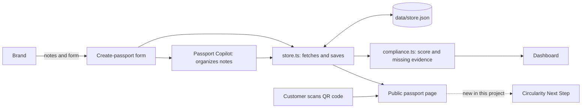

# Understanding ProductPass (Day 2 – Friday, Oct 16, 2026)

## What it is, and who uses it
ProductPass is an open-source prototype that helps small fashion and textile brands create a **digital product passport**: a web page for each product, reachable by a QR code, that shows what the product is made of, where it comes from, and what evidence supports its sustainability claims.

- **The brand** creates and manages passports (dashboard, create-passport form, evidence vault).
- **The customer** scans the QR code and reads the public passport page.

## The problem it solves
Brands will need to show reliable product information, and customers want to trust it. ProductPass collects that information in one place and shows what is still missing (for example, an expired certificate).

## Inputs and outputs
| | Inputs | Outputs |
|---|---|---|
| **ProductPass today** | Product data, materials, notes, supplier documents, photos | A structured passport, a public page, a QR code, missing-evidence alerts, a readiness score (0–100) |

The readiness score is an internal indicator, **not** a legal certification.

## How the information flows

## Map of screens
| Screen | Route | User |
|---|---|---|
| Home | `/` | Everyone |
| Dashboard | `/dashboard` | Brand |
| Products | `/products` | Brand |
| Create / edit passport | `/products/new`, `/products/[id]/edit` | Brand |
| Evidence Vault | `/evidence` | Brand |
| Public passport | `/passport/[publicId]` | Customer |

## What Passport Copilot already does
The Copilot takes **messy notes** a brand pastes in and turns them into **organized form fields** (product name, SKU, materials and percentages, care instructions) and flags green claims that need evidence. Without an AI key it works with simple pattern-matching rules (demo mode); with an OpenAI key it can use an AI model. It **organizes information. It does not advise the customer.**

## The opportunity
The public passport already shows a "Circular commerce" section with six buttons (repair, resell, register ownership, transfer ownership, find recycling point, end-of-life guidance), but they are **all disabled ("Coming soon")**. The app records what a product is made of, but never asks about the **condition** of the garment, and never helps the customer decide what to do next.

**My project, Circularity Next Step,** will sit between the stored passport and the customer's screen. It will take the customer's reported condition (good, damaged, or unknown) and suggest one first step: keep or donate, explore repair, or ask for more information, with a short reason and what is missing.

## Limits to be honest about
- It will not know the customer's **location** or which local services exist, so it will not recommend recycling automatically.
- It will not decide recyclability from the fiber type alone.
- This first version uses simple fixed rules and example data; it is not an AI agent.
