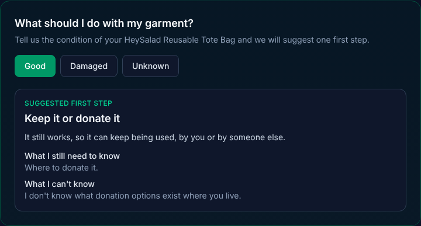
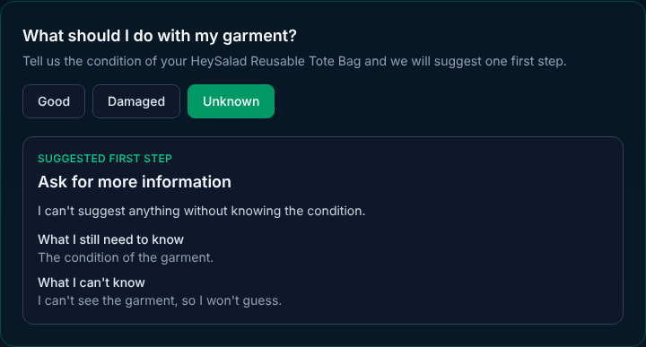

# Implementation – Circularity Next Step (Thursday, Oct 22, 2026)

## What I built
On the public passport page, a customer can now report the condition of their garment (Good, Damaged, or Unknown) and get one suggested first step, with a reason, what the app still needs to know, and what it can't know. The section appears just above the six "Circular commerce" boxes that were all marked "Coming soon".

## 1. Files changed
| File | New or edited | Why |
|---|---|---|
| `src/lib/circularity.ts` | New (Day 4) | The logic. The function `getCircularitySuggestion(product, condition)` applies my three fixed rules. Only the condition decides the answer |
| `src/components/passport/CircularityNextStep.tsx` | New (Day 5) | The screen. Three buttons and the result card. It keeps my feature in its own file, apart from the original code |
| `src/components/passport/PublicPassportView.tsx` | Edited, 3 lines | The only place the original page needed to know about my feature: it imports the new section and shows it above "Circular commerce" |

Commits: `3c6c483` (the function) and `eff266c` (the screen).

## 2. What happens when a customer clicks a button
1. The customer scans the QR code and the public passport page opens, with the passport already loaded.
2. The new section shows three buttons: Good, Damaged, Unknown. No result is shown yet.
3. The customer clicks one. The page remembers the choice.
4. The page calls `getCircularitySuggestion` with the passport and the chosen condition. The function applies the matching rule and returns four things: the action, the reason, the missing information, and the limitation notice.
5. The page shows those four things in a card.

The passport supplies the garment's name. The customer supplies the condition. Nothing is saved: if the page is reloaded, the choice is gone.

## 3. What I didn't change, and why
- **The six "Circular commerce" boxes** stay as "Coming soon". My feature covers one first step, not repair partners, resale, or recycling points.
- **The existing logic** (`store.ts`, `compliance.ts`, Passport Copilot) is untouched. My feature only reads the passport and doesn't write to it.
- **Recycling advice:** the app doesn't know the customer's location or which services exist near them, so it doesn't suggest recycling.
- **No new libraries, no AI, no database.**

## How I checked it
- The project type-checks and passes the linter with the new files.
- I ran the app in Claude's cloud workspace (not on my own computer) and clicked each button in a browser. The results matched my specification.
- The only error in the browser console was the product photo failing to load, which was already happening before my change.

## Screenshots
| Good | Damaged | Unknown |
|---|---|---|
|  |  |  |
