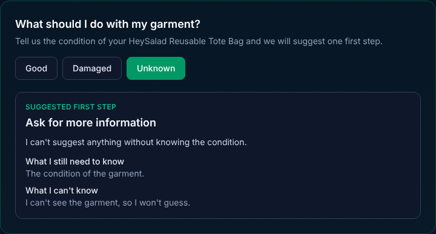

# Tests – Circularity Next Step (Thursday, Oct 22, 2026)

## How I tested
I ran the app in Claude's cloud workspace (not on my own computer), opened the public passport page of the HeySalad Reusable Tote Bag, and clicked each button in a real browser. For each case I compared what the app showed against the expected answer in `docs/especificacion-v1.md`. All three cases use the same garment, so that only the condition changes. This tests the rules, not the product.

## The three cases
| Case | Condition reported | Expected (from the specification) | Obtained | Failure | Correction |
|---|---|---|---|---|---|
| A | Good | **Keep it or donate it.** Reason: it still works, so it can keep being used. Missing: where to donate it. Limitation: I don't know what donation options exist where you live | Same action, missing information, and limitation | **Yes, in the wording.** My specification quoted a shorter reason than the app shows ("...can keep being used" instead of "...can keep being used, by you or by someone else"). The meaning was the same | Updated the specification to quote the app's exact wording. Re-ran the case: no differences |
| B | Damaged | **Explore repair.** Reason: a fix may make it usable again. Missing: what kind of damage it is. Limitation: I can't judge how serious the damage is or whether it can be repaired | Same action, missing information, and limitation | **Yes, in the wording.** Same cause: my specification quoted "...usable again" and the app says "...usable again before anyone throws it away" | Updated the specification. Re-ran the case: no differences |
| C | Unknown | **Ask for more information.** Reason: I can't suggest anything without knowing the condition. Missing: the condition of the garment. Limitation: I can't see the garment, so I won't guess | Exactly as expected | None | None needed |

The failures were in my document, not in the app. The app followed the rules in every case. The correction is the specification's last edit, in the same commit as this file.

## Extra checks
- **Before any click:** the page shows no suggestion. The customer has to choose first.
- **An unexpected value:** I called the function directly with a nonsense condition. It answered "Ask for more information", the same as Unknown, so a mistake never leads to a guess.

## Screenshots
| Case A: Good | Case B: Damaged | Case C: Unknown |
|---|---|---|
|  |  |  |

## Risk and limitation I noted
**The app can't tell whether the reported condition is true.** It takes the customer's choice at face value. If a customer chooses "Good" for a garment that is actually torn, the app will suggest keeping or donating it, and it has no photo or description to catch the mistake. The cost falls on the customer, who may be told to pass on a garment that nobody can use. Two things reduce this risk in this version:
1. The customer can change the choice at any time, because nothing is saved.
2. Every result shows what the app can't know, so the suggestion is never presented as a certainty.

A later version could ask follow-up questions (for example, about a tear, a stain, or a broken zipper) before suggesting anything.

## Other limitations
- The tests were run by hand, once, in a browser. The project has no automated test tool, and I didn't add one to keep the change small.
- The tests cover one garment and the three conditions. They don't cover other products, other languages, or other devices.
- The product photo doesn't load in Claude's workspace because its network blocks the image site. This was already the case before my change and doesn't affect the feature.
